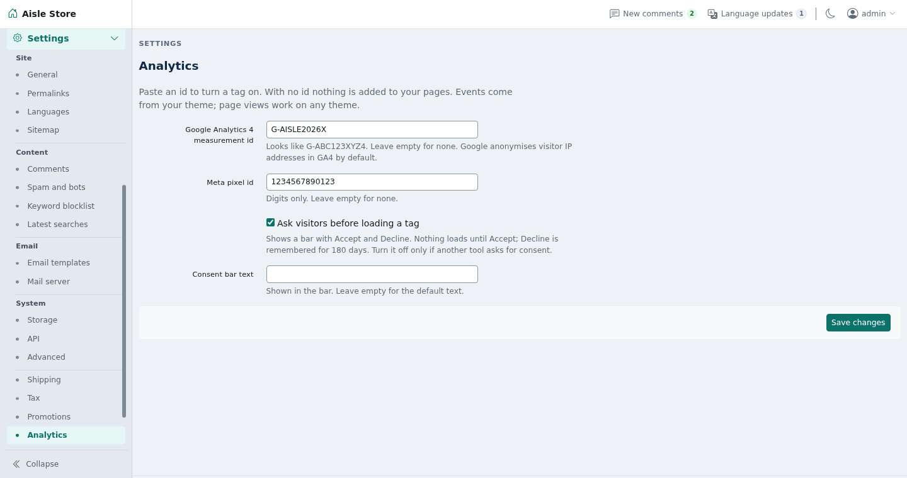
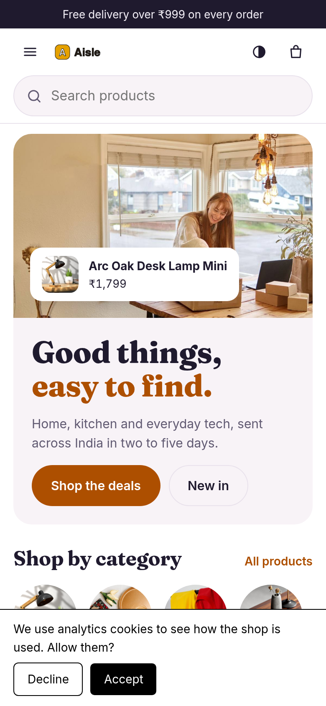

# Analytics

Adds Google Analytics 4 and Meta Pixel to a Shopclass site, with a built-in consent bar. Nothing is added to a page until you save an id, and no tag loads until the visitor accepts.

## Requirements

- Shopclass 7.0.0 or later
- PHP 8.0 or later
- A Google Analytics 4 measurement id, a Meta pixel id, or both

## Install

1. Open Plugins → Browse (or upload the zip from the GitHub release).
2. Install.
3. Activate.

## Set up

1. Open Settings → General → Analytics.
2. Enter the **Google Analytics 4 measurement id**. It looks like `G-ABC123XYZ4`: `G-` plus 4 to 12 letters or digits.
3. Enter the **Meta pixel id**: 5 to 20 digits. Leave a field empty to skip that tag.
4. Keep **Ask visitors before loading a tag** on, unless another tool already asks for consent.
5. Optional: write your own **Consent bar text**. Empty uses the default.
6. Save. A bad id is refused.

## How it works

- With the bar on, visitors see it on the first page, with Accept and Decline.
- Accept loads the tags and sends the page view and the events so far.
- Decline loads nothing and is remembered for 180 days.
- The choice is kept in `localStorage` (`analytics-consent`), not a cookie, so cached pages stay cached.
- GA4 anonymises visitor IP addresses by default.
- After Accept, the plugin sends page views, product ids, names, prices, quantities, order totals and search terms to Google (`googletagmanager.com`) and Meta (`connect.facebook.net`).
- Nothing is printed on admin, API or `?osc_preview=1` pages, or on pages whose address has a `code`, `secret` or `token` (password reset, activation, listing edit and mail confirm links).

Shop events need ShopClass 7.1, which is not released yet, and a theme that publishes them. Aisle, the shop theme coming with 7.1, does. The theme publishes GA4-named events to `window.aisleTrack` and to the `aisle:track` event on `document`. GA4 gets each one under its own name. The pixel gets these:

| Theme event | Meta event |
| --- | --- |
| `view_item` | ViewContent |
| `add_to_cart` | AddToCart |
| `begin_checkout` | InitiateCheckout |
| `add_payment_info` | AddPaymentInfo |
| `purchase` | Purchase |
| `search` | Search |
| `sign_up` | Lead |

## Notes / limits

- On ShopClass 7.0, and on themes that do not publish shop events, you get page views only.
- The tags set their own cookies after Accept.
- The bar is a plain opt-in, not legal advice. Check what your market requires and say so in your privacy page.
- The plugin stores four preferences (the two ids, bar on or off, bar text). Uninstall removes them. Nothing is stored per visitor on the server.

## For developers

- The plugin prints one `<script type="application/json" id="analytics-config">` on the `header` hook and queues `public/analytics.js`.
- The filter `analytics_skip` (default `false`) lets a plugin skip its own pages.
- Run tests with `tests/run.sh` (PHP and Node, no core or network needed).

## Support

https://github.com/mindstellar/shopclass-plugin-analytics/issues

## License

GPL-3.0-or-later
